### Hey, I'm Junaid

I build AI products and developer tools, contribute to open source, and run developer communities. Google Summer of Code 2026 with Apache Beam, Kubernetes v1.37 release team, Qwen ambassador.

[Website](https://junaidshaukat.com) · [LinkedIn](https://www.linkedin.com/in/junaiddshaukat) · [X](https://x.com/junaiddshaukat) · [YouTube](https://www.youtube.com/@junaiddshaukat) · [Email](mailto:junaidshaukat546@gmail.com)

<picture>
  <source media="(prefers-color-scheme: dark)" srcset="./assets/stats-dark.svg">
  <source media="(prefers-color-scheme: light)" srcset="./assets/stats-light.svg">
  
</picture>

## Things I built

<table>
<tr>
<td width="50%" valign="top">

**[isDisposable](https://isdisposable.com)** &nbsp;`API + SDKs`

Throwaway email detection. 160,000 known domains, live DNS checks and a risk score, with offline SDKs for npm and PyPI.

<!--stat:isdisposable_npm-->81.1k<!--/stat--> npm downloads · [Website](https://isdisposable.com) · [SDK](https://github.com/isdisposable/js)

</td>
<td width="50%" valign="top">

**[Divisio](https://github.com/junaiddshaukat/Divisio)** &nbsp;`macOS app`

Claude Code, Codex, Cursor, Grok and more in one window. Each agent gets its own git worktree, and nothing lands until you've read the diff.

Open source, MIT · [Download](https://github.com/junaiddshaukat/Divisio/releases/latest) · [Website](https://junaidshaukat.com/divisio)

</td>
</tr>
<tr>
<td width="50%" valign="top">

**[blyn](https://apps.apple.com/us/app/blyn-ai-money-coach/id6799817602)** &nbsp;`iOS app`

An AI money coach that runs on your phone. It tracks spending against category limits and tells you what's left. Your data never leaves the device.

Live on the App Store · [App Store](https://apps.apple.com/us/app/blyn-ai-money-coach/id6799817602)

</td>
<td width="50%" valign="top">

**[tkntracker](https://github.com/junaiddshaukat/tkntracker)** &nbsp;`CLI`

See the tokens you burn across Claude Code, Codex, Cursor and 20 more agents. Reads local logs only. No account, no API keys.

<!--stat:tkntracker_npm-->273<!--/stat--> npm downloads · [npm](https://www.npmjs.com/package/tkntracker)

</td>
</tr>
</table>

Also: [Storage Sweep](https://junaidshaukat.com/storage-sweep), a macOS cleaner for developer caches · [reqcraft](https://github.com/junaiddshaukat/reqcraft), a 3 kB axios-compatible client on `fetch` · [QueryMaster](https://github.com/junaiddshaukat/querymaster), an MCP server for SQL in plain English. [All projects](https://junaidshaukat.com/projects)

## Open source

<!--stat:merged-->89<!--/stat--> merged PRs to projects I don't own. This table rebuilds daily from the GitHub API.

<!--oss:start-->

| &nbsp;&nbsp;&nbsp;&nbsp;&nbsp;&nbsp; | Project | Merged | What I did |
| :-: | :-- | :-: | :-- |
|  | <a href="https://github.com/apache/beam"><b>Apache&nbsp;Beam</b></a> | [43](https://github.com/search?type=pullrequests&q=is%3Apr%20is%3Amerged%20author%3Ajunaiddshaukat%20repo%3Aapache%2Fbeam) | Wrote the portable Kafka Streams runner, so pipelines from any Beam SDK run on Kafka Streams. Ships in the nightly snapshots. |
|  | <a href="https://github.com/InsForge/InsForge"><b>InsForge</b></a> | [12](https://github.com/search?type=pullrequests&q=is%3Apr%20is%3Amerged%20author%3Ajunaiddshaukat%20repo%3AInsForge%2FInsForge%20repo%3AInsForge%2FInsForge-sdk-js%20repo%3AInsForge%2Finsforge-swift%20repo%3AInsForge%2Finsforge-kotlin) | Custom OAuth providers end to end, then carried into the JS, Swift and Kotlin SDKs. Signup controls, PostgREST operators for Kotlin, dashboard fixes. |
|  | <a href="https://github.com/devweekends/web-platform"><b>Dev&nbsp;Weekends</b></a> | [8](https://github.com/search?type=pullrequests&q=is%3Apr%20is%3Amerged%20author%3Ajunaiddshaukat%20repo%3Adevweekends%2Fweb-platform) | The community platform. Careers, projects and testimonials pages, a security cleanup, and a self-hosted links page. |
|  | <a href="https://github.com/archestra-ai/archestra"><b>Archestra</b></a> | [6](https://github.com/search?type=pullrequests&q=is%3Apr%20is%3Amerged%20author%3Ajunaiddshaukat%20repo%3Aarchestra-ai%2Farchestra) | Enterprise MCP gateway. Added the Mistral, Cerebras, DeepSeek and Perplexity providers, and fixed Kubernetes service names for long MCP server names. |
|  | <a href="https://github.com/PalisadoesFoundation/talawa-admin"><b>Talawa&nbsp;Admin</b></a> | [6](https://github.com/search?type=pullrequests&q=is%3Apr%20is%3Amerged%20author%3Ajunaiddshaukat%20repo%3APalisadoesFoundation%2Ftalawa-admin) | Built the i18n notification toast and moved the app onto it. Turned on advanced tree-shaking in Vite; the bundle got 30% smaller. |
|  | <a href="https://github.com/apache/airflow"><b>Apache&nbsp;Airflow</b></a> | [3](https://github.com/search?type=pullrequests&q=is%3Apr%20is%3Amerged%20author%3Ajunaiddshaukat%20repo%3Aapache%2Fairflow) | Fixed user creation in the FAB auth manager when no role is given. E2E tests for Asset Details. |
|  | <a href="https://github.com/voiceyBill/voiceyBill-App"><b>voiceyBill</b></a> | [3](https://github.com/search?type=pullrequests&q=is%3Apr%20is%3Amerged%20author%3Ajunaiddshaukat%20repo%3AvoiceyBill%2FvoiceyBill-App%20repo%3AvoiceyBill%2FvoiceyBill-web) | UI and auth overhauls across the mobile app and the web client. |
|  | <a href="https://github.com/google-gemini/gemini-cli"><b>Gemini&nbsp;CLI</b></a> | [2](https://github.com/search?type=pullrequests&q=is%3Apr%20is%3Amerged%20author%3Ajunaiddshaukat%20repo%3Agoogle-gemini%2Fgemini-cli) | Custom base URLs through env vars, and stricter audio MIME validation in file reads. |
|  | <a href="https://github.com/webpack/webpack"><b>webpack</b></a> | [2](https://github.com/search?type=pullrequests&q=is%3Apr%20is%3Amerged%20author%3Ajunaiddshaukat%20repo%3Awebpack%2Fwebpack) | Merged the propertyAccess and propertyName utils into one module. Config coverage for Electron targets. |
|  | <a href="https://github.com/topoteretes/cognee"><b>Cognee</b></a> | [1](https://github.com/search?type=pullrequests&q=is%3Apr%20is%3Amerged%20author%3Ajunaiddshaukat%20repo%3Atopoteretes%2Fcognee) | An incremental Gmail connector for the agent memory layer. |
|  | <a href="https://github.com/jaegertracing/jaeger"><b>Jaeger</b></a> | [1](https://github.com/search?type=pullrequests&q=is%3Apr%20is%3Amerged%20author%3Ajunaiddshaukat%20repo%3Ajaegertracing%2Fjaeger) | Timer duration bucket parsing in the metrics init. |
|  | <a href="https://www.kernel.org"><b>Linux&nbsp;kernel</b></a> | patches | Built and booted mainline on ARM64, then sent patches the old way, with git format-patch and git send-email. |

Plus 2 more in [ContextVM/sdk](https://github.com/ContextVM/sdk), [dailydotdev/apps](https://github.com/dailydotdev/apps).

<!--oss:end-->

## Community

- **Qwen Ambassador.** Started Qwen Pakistan from scratch. 3,000+ followers and 250K+ impressions in the first week, then the AI Buildathon 2026.
- **RevenueCat Shipaton IRL.** Hosted the first in-person Shipaton in Pakistan. 43 signed up.
- **Replit Campus Leader.** Before that, Notion Campus Leader for a year.
- **Dev Weekends.** Internal operations, fellowships, mentorship, and a weekly cohort of 40 engineers.

## Recognition

- Google Summer of Code 2026, Apache Software Foundation · [project](https://summerofcode.withgoogle.com/programs/2026/projects/x13a0jGL)
- Kubernetes v1.37 release team, Release Signal Shadow
- Winner, Cognee AI PR hackathon
- 2nd place, InsForge PR hackathon
- Top 100 in Pakistan, Meta Hacker Cup 2024

## Writing

**[LLM Engineering](https://junaidshaukat.com/courses/llm-engineering)** is a free 17-lesson course, from what an LLM is to fine-tuning, serving, RAG, agents and evals.

- [The Second Run](https://junaidshaukat.com/blog/the-second-run)
- [How to Train a Small LLM Without Burning Money](https://junaidshaukat.com/blog/how-to-train-a-small-llm-without-burning-money)
- [More Context Is Making Your AI Dumber](https://junaidshaukat.com/blog/more-context-is-making-your-ai-dumber)

[All posts](https://junaidshaukat.com/blog)
